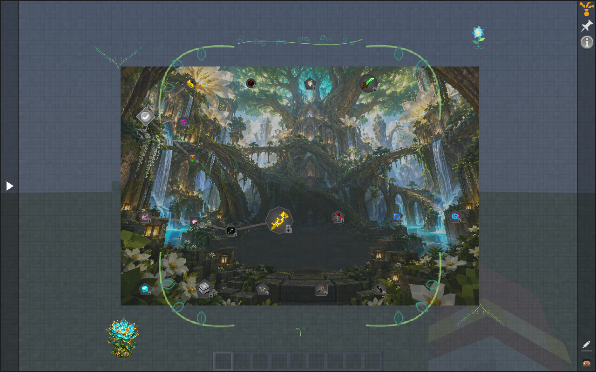
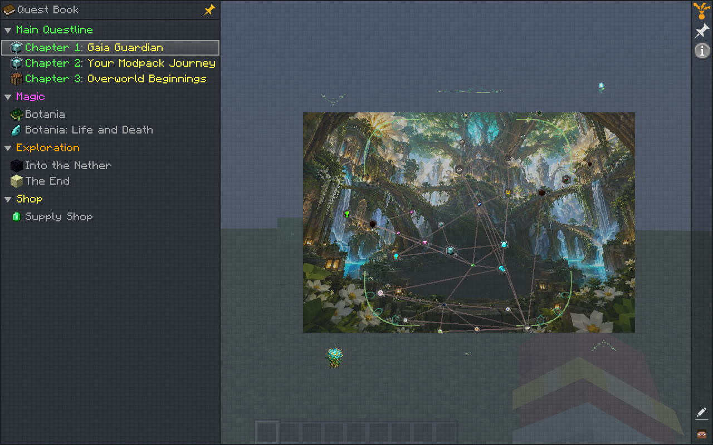
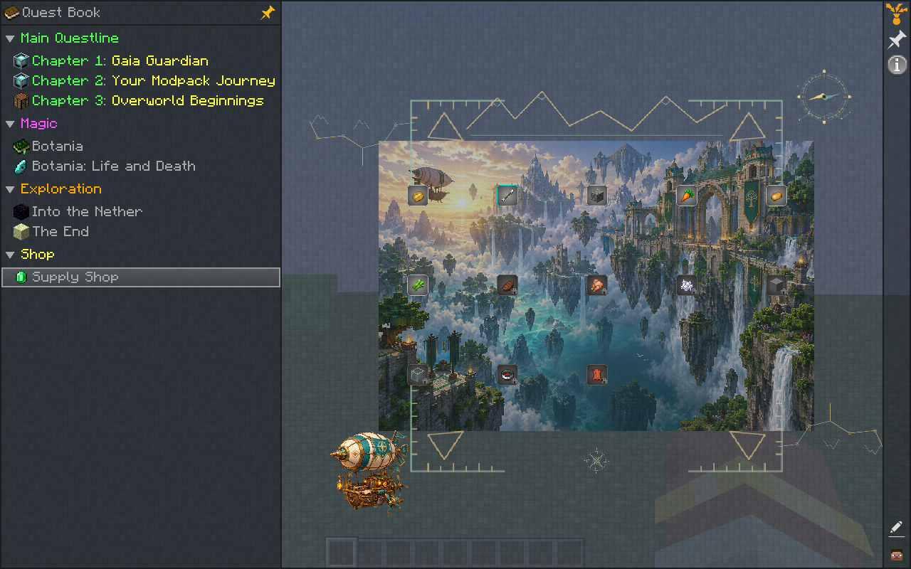

# FTB Quests Generator

**7.13 / release v0.2.7-beta** · Windows desktop app · Minecraft 1.20.1 Forge and 1.21.1 NeoForge

[Download the Windows app](https://github.com/Antidqrk/AutoQuestGen/releases/download/v0.2.7-beta/AutoQuestGen.exe) · [Release and optional artwork downloads](https://github.com/Antidqrk/AutoQuestGen/releases/tag/v0.2.7-beta)

Create connected, illustrated quest books from your installed Minecraft modpack. The generator uses local items, recipes and curated progression guides—fully offline, with no AI service, account or API key.



## What it makes

- Branched questlines with real prerequisites, useful descriptions and a clear campaign goal.
- Full selected-mod books or focused routes for supported goals such as **defeat the Gaia Guardian**. Boss goals use kill objectives; actions the game cannot detect use labelled manual checkpoints.
- **110 bundled artworks** across twelve themes: 26 landscapes, 12 illustrated landmarks, 60 decorative graphics and **12 native Minecraft animations**.
- ATM-inspired chapter categories, a prominent main questline, varied quest node sizes, and controllable artwork, motion and decoration sizes.
- An optional emerald supply shop with repeatable purchases, progress-gated shelves and adjustable prices. No extra currency mod is needed.
- A local interactive preview so you can read objectives and inspect the map before saving it.



## Make a quest book

1. Open **Choose pack**, select an installed instance, then click **Scan this pack**.
2. In **Quest book**, start with **Epic · ATM-inspired** or **Balanced**. To add a campaign, enable **Connect chapters into a campaign with a final goal** and enter a **Goal of your modpack**. Keep **Book scope → Selected mods + goal** for the wider book, or choose **Goal-focused quest book** for a focused route.
3. Expand **Appearance & chapter organization** to choose **Quest node sizes**, **Art collection**, **Animated decorations in the quest book**, and **Decoration sizes**. **Browse artwork & animations…** opens the included gallery. For a shop, expand **Optional quest book shop** and enable **Include an emerald supply shop**.
4. Open **Preview & build** and click **Preview quest book**. When ready, close Minecraft, check **Save quest book to**, and click **Build quest book**.
5. Launch the selected pack and open FTB Quests. When sharing a book with custom artwork, distribute its companion **AutoQuestGen-Art.zip** and have players enable that resource pack.

The packaged Windows executable includes its runtime; Python is not required. The target Minecraft instance needs FTB Quests. Guide and recipe coverage depends on the installed mods and pack configuration; **Progression coverage** shows what the generator supports. The illustrations were created during development; using the app or exported book never runs an AI model.



## Verified for 7.13

- **493 automated checks** and **seven packaged executable cases** passed, covering book sizes, focused goals, scenarios, artwork settings and two shop configurations.
- The packaged ATM9 Normal example produced **391 quests across 45 chapters**. Counts vary with the pack and selected options.
- In isolated Minecraft 1.20.1 with FTB Quests 2001.4.21, all **98 static images** loaded correctly and all **12 animations** rendered changing frames. A static control stayed unchanged.
- Native shop checks verified two paid purchases, reward claims, repeat resets, and no reward for insufficient funds.

The screenshots above come directly from that isolated Minecraft test. The installed ATM9 pack was scanned read-only for generation checks; this is not a complete survival playthrough of every generated book.

## Install

Download **AutoQuestGen.exe** from the release, put it in a writable folder, and open it. Python is not needed. Keep local settings and scan caches in that folder. Reopen the app after replacing an older executable. The app is unsigned; the source and SHA256 checksums are published with the release.

The executable already includes the complete artwork library. The optional artwork archive includes PNGs, GIF previews, original illustration prompts, and editable decoration sources. Its embedded standalone resource pack targets Minecraft 1.21.1; use the app export for the correct format for your selected instance.

## Compatibility and scope

FTB Quests must be installed in the target modpack. The generator scans existing mod files; it does not install mods, change world generation, or simulate every possible scripted recipe. The curated library contains 60 explicit branched guides with 1,342 authored milestones, plus older researched chains and local recipe discovery. Supported mechanics and version notes are shown in Progression coverage. Unknown runtime registrations and unsupported scripts need author review.

Reference quest content can be read from a book already installed locally when reference objectives are enabled. This public distribution excludes copied reference templates, raw research corpora, mod JARs and modpack files. The artwork is original. This is an experimental beta, and generated books should be previewed and reviewed before sharing.

## Credits and license

Created by **antidqrk**. The original app was built with Claude, with subsequent development and verification using Codex. Source, bundled original artwork and distributed research data use the existing [MIT license](LICENSE). Third-party mods and locally reused reference content retain their own licenses. AutoQuestGen is independent of the All the Mods team, FTB, Mojang and Microsoft.

## Run from source

The published source contains the sanitized runtime data and original bundled artwork. It does not require downloaded research files, a private modpack, an AI model, or an API key.

The verified development environment is **Windows, CPython 3.13.2**, with Tk included from the python.org installer. To create an isolated environment, install dependencies, and launch the app:

```powershell
py -3.13 -m venv .venv
.\.venv\Scripts\python.exe -m pip install -r requirements-dev.txt
.\.venv\Scripts\python.exe autoquestgen.py
```

Package versions are pinned to the release environment. Installing packages needs access to a package index (or a local wheel cache); generating and previewing quest books is offline. The source retains optional legacy metadata helpers, but no AI or account setup is part of the offline interface.

## Developer checks

```powershell
.\.venv\Scripts\python.exe run_tests.py
```

This runs each public test identity once, including scanner fixtures, progression, campaigns, scenarios, exports, settings, native artwork, and Tk interface checks. Fixtures construct small synthetic JARs and temporary output folders. No installed modpack is required. Network connections in the main test process are blocked during the run.

For an environment without a graphical desktop, use `python run_tests.py --no-gui`; this deliberately omits Tk interface tests. Installed-pack and Minecraft playtesting are separate from this portable regression suite.

## Build the Windows application

```powershell
.\.venv\Scripts\python.exe build_release.py --stage
.\.venv\Scripts\python.exe build_release.py
```

The first command verifies and assembles only runtime files into `build/stage/`. The second also uses PyInstaller to create `dist/AutoQuestGen.exe`. `build/manifest.json` records the final staged file sizes and SHA-256 hashes. It excludes development fixtures, local settings, caches, generated quest books, downloaded mods, and private reference corpora.

This is a reproducible build procedure, not a promise of identical executable bytes across machines or build timestamps. Locally rebuilt executables are separate from the tested release download and should be smoke-tested before distribution.

## Edit the original native artwork

`tools/render_decor_assets.py` defines the 60 native ornaments; `tools/render_animated_decor.py` defines the 12 animated landmarks. Their geometry is editable Python code. The illustrated scenes and their recorded prompts are also included. Rendering is optional and uses Pillow from `requirements-dev.txt`; running the app does not regenerate images.

[Detailed release verification](docs/VALIDATION-7.13.md).
